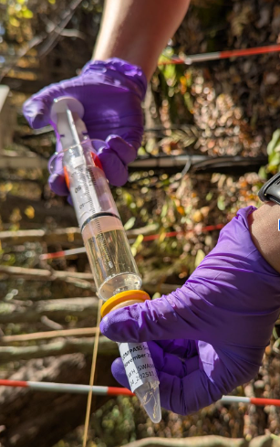

#Folder: synoptic-discrete-data/Porewater

Project: COMPASS - Synoptic Chesapeake Bay Sampling Type: Porewater and Surface Water Data Description: These data are from porewater collected from lysimeters and surface water at the COMPASS ‘synoptic’ sites in the Chesapeake Bay region: Moneystump Swamp (MSM), Goodwin Islands (GWI), GCReW (GCW), and Sweet Hall Marsh (SWH). These data provide crucial information about saltwater intrusion into the porewater of wetlands and coastal forests.

Porewater was collected from lysimeters installed at depths of 10 cm, 20 cm, and 45 cm in the Upland (UP), SWAMP (SWH only), Transition (TR), and Wetland Center(WC) zones at each site monthly from May to November in 2022; April to November in 2023 and 2024; and in every two months from May to November from 2025 to present. Porewater samples were collected in syringes and then processed for DIC, DOC, GHG, Iron, Nutrients, Sulfate/Chloride, and Sulfide.Porewater was also collected from peepers (2022-2023), rhizons(2022-2023), and sippers (2022) and certain sites.

This folder contains

*Folders for each analyte sampled from lysimeters and surface water, as well as separate folders for non-lysimeter porewater samples
*Raw data from each instrument for each analyte
*QAQC Codes and logs for each analyte
*Processed and QAQC’d data for each analyte
*Collated data for each analyte within and across years

**Figure 1. Porewater sampling syringe with syringe filter.

  
   

