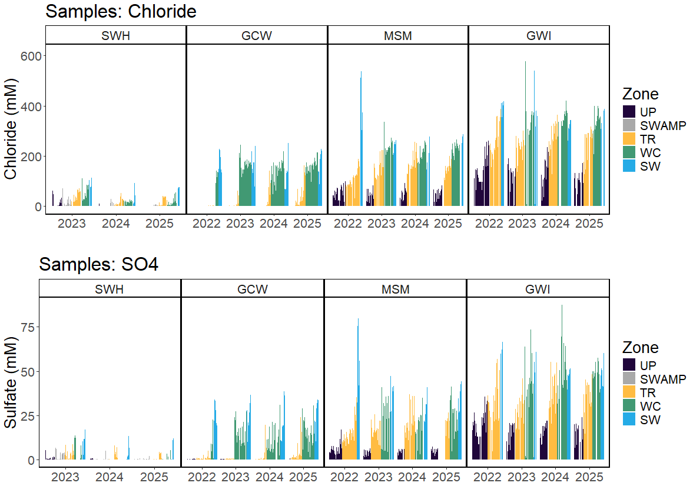
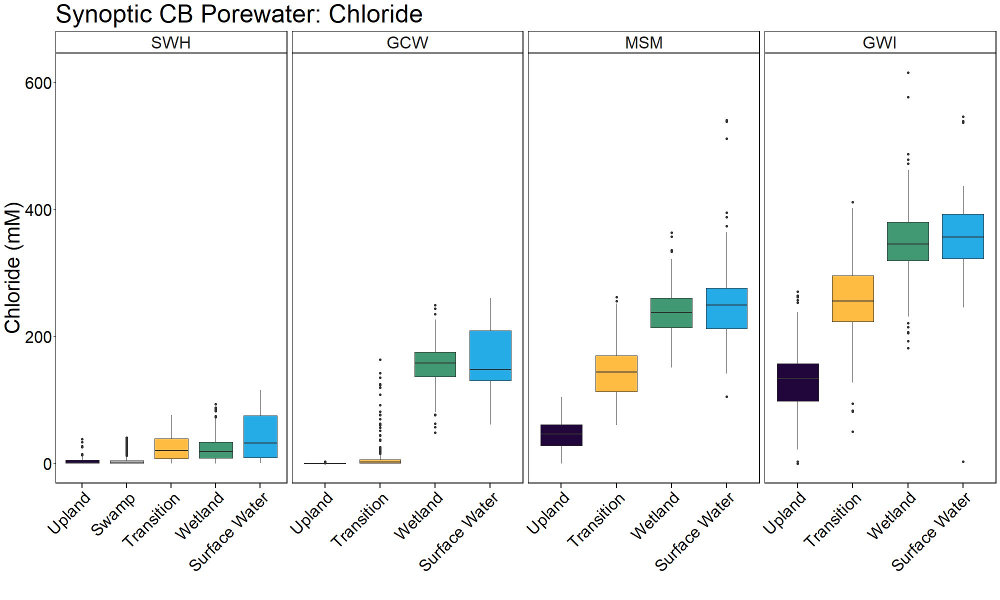
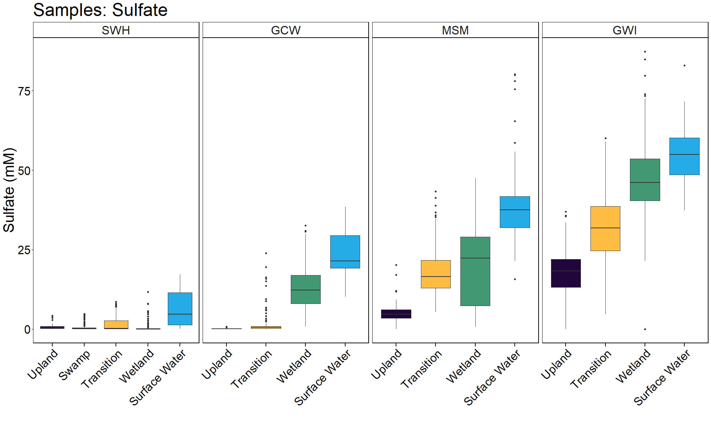
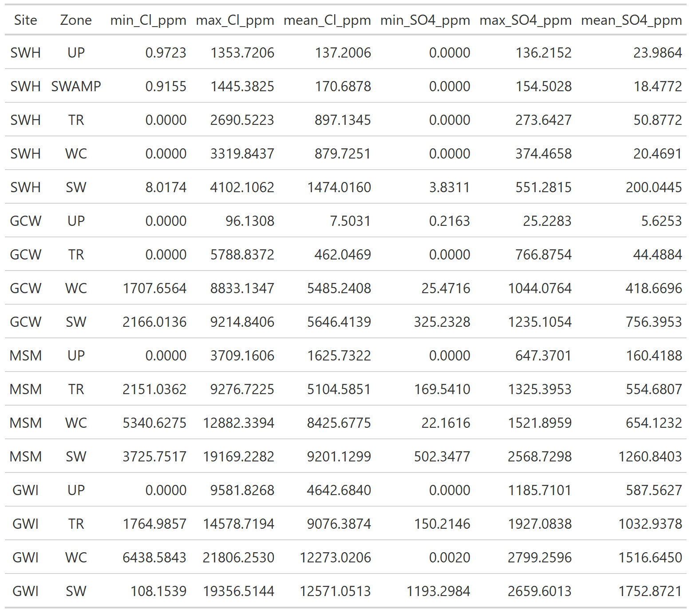

#Folder: synoptic-discrete-data/Porewater/Sulfate_Chloride

Project: COMPASS - Synoptic Chesapeake Bay
Analytes: Sulfate and Chloride
Sampling Type: Porewater and Surface Water
Data Description: These data are from porewater collected from lysimeters and surface water at the COMPASS 'synoptic' sites in the Chesapeake Bay region: Moneystump Swamp (MSM), Goodwin Islands (GWI), GCReW (GCW), and Sweet Hall Marsh (SWH). Porewater was collected from lysimeters installed at depths of 10 cm, 20 cm, and 45 cm in the Upland (UP), SWAMP (SWH only), Transition (TR), and Wetland Center(WC) zones at each site monthly from May to November in 2022; April to November in 2023 and 2024; and in every two months from May to November from 2025 to present. 

Porewater samples were collected in syringes, filtered through 0.45 ??m PVDF syringe filters, and 5 mL was added under 0.5 mL of 5% Zinc Acetate to fix the sample and prevent sulfide oxidation. 

This folder contains

* Annual folders for each year of sampling which includes: 
* Raw data from each instrument for each analyte
* QAQC codes and logs for each analyte 
* Processed and QAQC'd data for each analyte 
* Collated data for each analyte within and across years
* Laboratory analysis protocols

**Figure 1. Summary plot of chloride and sulfate across sites and zones**

  
   

**Figure 2. Summary boxplot of chloride across sites and zones**

  
   

**Figure 3. Summary boxplot of sulfate across sites and zones**

  
   

**Figure 4.Summary table of sulfate and chloride across sites and zones**

  
   

